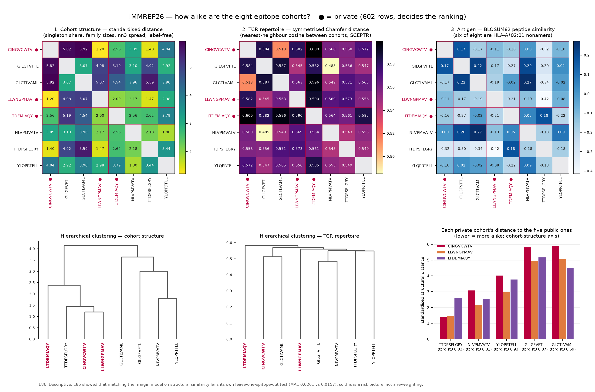

# E86 — A similarity map of the eight epitope cohorts

Three axes, because they order the epitopes differently.
Descriptive only: E85 established that matching on structure *fails*
its own leave-one-epitope-out test, so this is a risk picture and not
an input to the margin model.
Generated by `scripts/77_epitope_similarity_map.py`.

## The cohorts

| epitope | split | HLA | rows | singleton % | largest family | close pairs % | nn3 IQR | nn3 sd |
|---|---|---|---:|---:|---:|---:|---:|---:|
| CINGVCWTV | private | A2 | 243 | 97.5 | 2 | 0.01 | 0.1677 | 0.1137 |
| GILGFVFTL | public | A2 | 670 | 52.4 | 71 | 0.70 | 0.3445 | 0.1982 |
| GLCTLVAML | public | A2 | 192 | 44.8 | 32 | 1.27 | 0.3540 | 0.2041 |
| LLWNGPMAV | private | A2 | 229 | 95.6 | 4 | 0.03 | 0.2282 | 0.1413 |
| LTDEMIAQY | private | A1 | 130 | 85.4 | 7 | 0.23 | 0.1239 | 0.1682 |
| NLVPMVATV | public | A2 | 366 | 81.7 | 17 | 0.15 | 0.2253 | 0.1794 |
| TTDPSFLGRY | public | A1 | 387 | 95.3 | 5 | 0.02 | 0.1360 | 0.1343 |
| YLQPRTFLL | public | A2 | 419 | 81.6 | 12 | 0.11 | 0.3852 | 0.1972 |

## Nearest public epitope to each private one

### cohort structure

| private | 1st | 2nd | 3rd | 4th | 5th |
|---|---|---|---|---|---|
| CINGVCWTV | TTDPSFLGRY (1.40) | NLVPMVATV (3.09) | YLQPRTFLL (4.04) | GILGFVFTL (5.82) | GLCTLVAML (5.92) |
| LLWNGPMAV | TTDPSFLGRY (1.47) | NLVPMVATV (2.17) | YLQPRTFLL (2.98) | GILGFVFTL (4.98) | GLCTLVAML (5.07) |
| LTDEMIAQY | NLVPMVATV (2.56) | TTDPSFLGRY (2.62) | YLQPRTFLL (3.79) | GLCTLVAML (4.54) | GILGFVFTL (5.19) |

### TCR repertoire

| private | 1st | 2nd | 3rd | 4th | 5th |
|---|---|---|---|---|---|
| CINGVCWTV | GLCTLVAML (0.51) | TTDPSFLGRY (0.56) | NLVPMVATV (0.56) | YLQPRTFLL (0.57) | GILGFVFTL (0.58) |
| LLWNGPMAV | GILGFVFTL (0.54) | YLQPRTFLL (0.56) | GLCTLVAML (0.56) | NLVPMVATV (0.57) | TTDPSFLGRY (0.57) |
| LTDEMIAQY | TTDPSFLGRY (0.56) | NLVPMVATV (0.56) | GILGFVFTL (0.58) | YLQPRTFLL (0.58) | GLCTLVAML (0.60) |

### peptide (BLOSUM62)

| private | 1st | 2nd | 3rd | 4th | 5th |
|---|---|---|---|---|---|
| CINGVCWTV | GILGFVFTL (0.17) | NLVPMVATV (0.00) | YLQPRTFLL (-0.10) | GLCTLVAML (-0.17) | TTDPSFLGRY (-0.32) |
| LLWNGPMAV | YLQPRTFLL (-0.08) | NLVPMVATV (-0.13) | GILGFVFTL (-0.17) | GLCTLVAML (-0.19) | TTDPSFLGRY (-0.42) |
| LTDEMIAQY | TTDPSFLGRY (0.18) | NLVPMVATV (0.05) | GLCTLVAML (-0.02) | YLQPRTFLL (-0.22) | GILGFVFTL (-0.27) |

## Do the three axes agree?

Spearman over the 28 epitope pairs, all three as distances.

| axis | axis | ρ |
|---|---|---:|
| structure | repertoire | -0.073 |
| structure | peptide | +0.032 |
| repertoire | peptide | +0.133 |

## Does proximity to the private cohorts track difficulty?

The bar panel labels each public epitope with tcrdist3's published
AUROC, which invites reading *closer* as *easier*. It does not hold.

| public epitope | mean distance to the three private | tcrdist3 |
|---|---:|---:|
| GILGFVFTL | 5.33 | 0.871 |
| GLCTLVAML | 5.18 | 0.690 |
| NLVPMVATV | 2.61 | 0.809 |
| TTDPSFLGRY | 1.83 | 0.826 |
| YLQPRTFLL | 3.60 | 0.928 |

Spearman **+0.100** over five points.

## Figure

